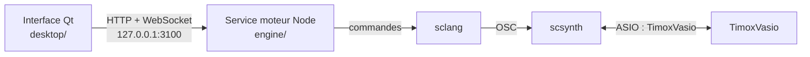
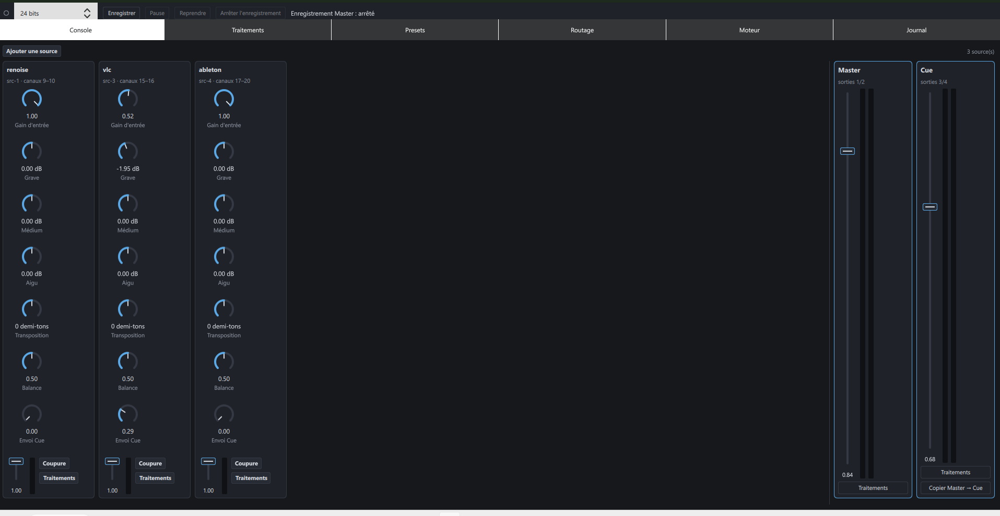
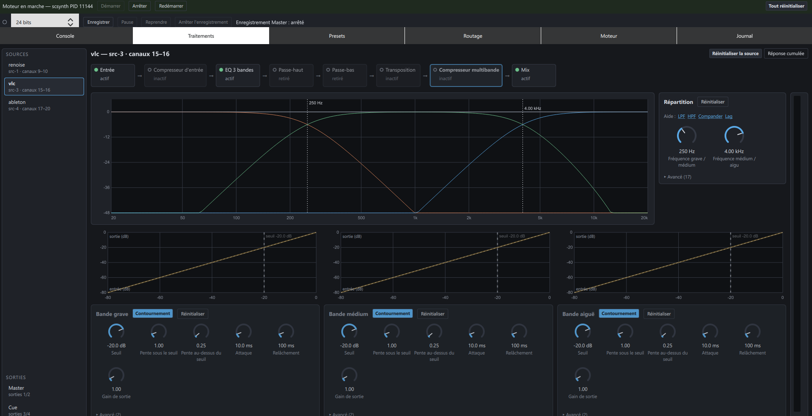
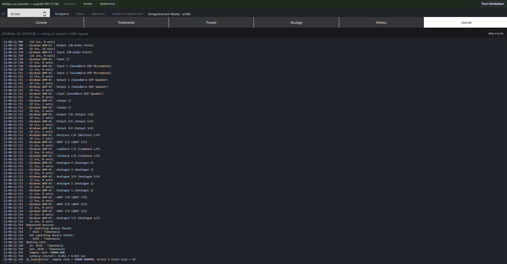

# SCMixer

Console de mixage multi-source sur SuperCollider pour Windows, conçue pour fonctionner avec **TimoxVasio**. Le moteur s'appuie sur son pilote ASIO virtuel et son API locale pour l'audio et le routage ; TimoxVasio doit être installé et son moteur audio configuré. SCMixer affiche les routes TimoxVasio et gère ses sources ainsi que ses bus logiques Master/Cue.



## Contenu

| Dossier | Rôle |
|---|---|
| `engine/` | Service moteur (Node.js) : API HTTP et WebSocket, contrat `engine/openapi.yaml`, graphe SuperCollider `engine/sc/`. Voir `engine/README.md`. |
| `desktop/` | Interface Qt 6.12 (QML et C++) : console, traitements avec graphes, presets, routage, moteur, journal. Voir `desktop/README.md`. |
| `installer/` | Installateur Qt Installer Framework (interface, service, SuperCollider embarqué) et script de release. Voir `installer/README.md`. |
| `docs/` | Spécification, plans de réalisation et maquettes. |

L'API est le seul point de passage entre l'interface et le moteur : l'interface ne lit aucun fichier du moteur et n'affiche que l'état confirmé par l'API.

## Captures d’écran

La console réunit les sources, les niveaux Master/Cue et leurs contrôles :



Les chaînes de traitement affichent les graphes et réglages de la source sélectionnée :



Le journal montre l’inventaire audio détecté par SuperCollider pendant le démarrage :



## Installation

Télécharger `SCMixer-<version>-Setup.exe` depuis la page [Releases](https://github.com/timox/SCMixer/releases). Prérequis vérifiés par l'installateur :

- Node.js 22 ou plus récent dans le `PATH` ;
- le pilote ASIO TimoxVasio enregistré (`HKLM\SOFTWARE\ASIO\TimoxVasio`).

SuperCollider 3.14.1 est embarqué. Le raccourci « SCMixer » démarre le service moteur puis l'interface. Les données (session, presets, journaux) restent dans `%LOCALAPPDATA%\SCMixer`, y compris après désinstallation.

## Développement

```
cd engine && npm ci && npm test
cd desktop && cmake --preset mingw && cmake --build --preset mingw && ctest --preset mingw
engine\engine.cmd start
desktop\start-desktop.cmd
```

Prérequis : Node.js, SuperCollider 3.14.1 dans `C:\Program Files\SuperCollider-3.14.1`, Qt 6.12.0 MinGW 64 dans `C:\Qt`, TimoxVasio.

## Licences

SuperCollider est distribué sous licence GPL version 3 (`COPYING`, copié dans le dossier `supercollider` de l'installation) ; ses sources sont publiées par le projet SuperCollider (étiquette `Version-3.14.1` de github.com/supercollider/supercollider). Qt est utilisé sous licence LGPL version 3.
