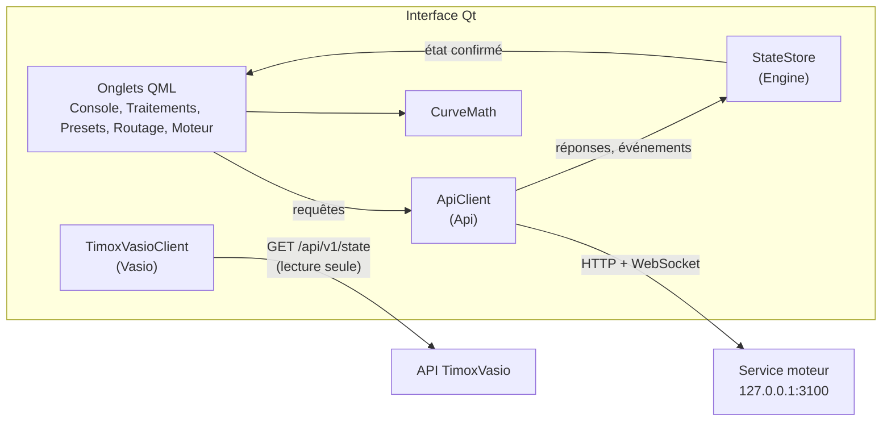

# Interface Qt du moteur de SCMixer

Application native Qt 6.12 (QML et C++) qui pilote, à la souris, tous les réglages du moteur SC par sa seule API (HTTP et WebSocket), et affiche en lecture seule le routage TimoxVasio.

## Architecture



- **Seul point d'entrée : l'API du moteur.** L'interface ne lit aucun fichier du moteur (session, presets, registre). Sa seule configuration est l'adresse de l'API, `SCMIXER_ENGINE_URL` (défaut `http://127.0.0.1:3100`). L'adresse de TimoxVasio et le PID de scsynth viennent de `GET /api/engine`.
- **Pas d'état optimiste.** `StateStore` n'est modifié que par une réponse de l'API ou un événement WebSocket. Pendant un glissement, un contrôle affiche sa position ; au relâchement, il revient à la valeur confirmée.
- **Plages venant de l'API.** Plages, pas, défauts, unités, échelles, libellés, groupes (principal, avancé), conversions vers la grandeur jouée (Hz, dB) et conditions d'usage (largeur de source, modèle) viennent de `GET /api/parameters`. La chaîne de chaque source et de chaque sortie (ordre, état, modèle, liens vers l'aide SuperCollider des UGens utilisés) vient de `GET …/processing-graph`. Aucune plage n'est écrite dans le QML ou le C++ ; `tests/tst_noranges.cpp` le vérifie.
- **Regroupement des réglages.** Pour un même chemin, une seule requête `PUT` est en vol ; la plus récente remplace celle en attente.
- **Connexion.** Sans connexion, un bandeau « API indisponible » s'affiche, les contrôles sont désactivés et une reconnexion est tentée toutes les 2 s. À chaque connexion, l'état complet et le catalogue des paramètres sont relus.

## Construction

Prérequis : Qt 6.12.0 MinGW 64 (`C:\Qt\6.12.0\mingw_64`) avec Qt WebSockets, CMake et Ninja de `C:\Qt\Tools`.

```
cd desktop
cmake --preset mingw
cmake --build build\mingw
ctest --preset mingw
```

Les données de test (`tests/fixtures/state.json`, `parameters.json`) sont des réponses de l'API, produites par `node engine/tools/export-fixtures.mjs`. Elles sont à régénérer après tout changement du contrat.

## Lancement

1. Démarrer le service moteur : `engine\engine.cmd start`. L'interface ne le lance pas.
2. Lancer l'interface : `desktop\start-desktop.cmd`.
3. Démarrer le moteur depuis l'onglet Moteur.

Option de vérification : `scmixer.exe --capture <dossier>` attend l'état de l'API, enregistre une capture PNG de chaque onglet puis de chaque page d'étage (première source, Master), puis quitte.

## Onglets

| Onglet | Contenu |
|---|---|
| Console | Une tranche par source (fader, vumètre, coupure, gain, EQ en dB, transposition, balance, envoi Cue), puis les tranches Master et Cue (volume, vumètres L/R, « Copier Master → Cue »). Le bouton « Traitements » d'une tranche ouvre l'onglet Traitements sur l'élément. La boîte de source permet la création, la modification et la suppression (sur confirmation). |
| Traitements | À gauche les sources, Master et Cue. À droite, la chaîne de traitement en blocs reliés dans l'ordre du signal (voyant actif ou contourné, modèle chargé, alerte si le modèle demandé n'est pas chargé) ; un clic ouvre l'étage : son graphe à côté de ses réglages (réponse en fréquence de l'EQ, des filtres, de la répartition multibande et des passe-haut de sortie ; courbes de transfert des compresseurs, du limiteur et de l'écrêteur ; position stéréo ; hauteur). Pendant un glissement, le graphe trace un aperçu en pointillés ; la courbe pleine reste la valeur confirmée par l'API. Chaque étage donne les liens vers l'aide SuperCollider de ses UGens. Les vumètres restent visibles à droite. |
| Presets | Liste, enregistrement de la session ; application et suppression après un second clic de confirmation. |
| Moteur | Démarrer, arrêter, redémarrer selon l'état ; horloge audio en lecture seule (réglée dans TimoxVasio) ; indicateurs d'exécution ; arbre des nœuds ; bancs compresseur et EQ. |
| Routage | Pour chaque canal de source, ce qui l'alimente ; destinations de Master et Cue. Lecture seule : les routes se modifient dans TimoxVasio. |

Sous la barre moteur, visible sur tous les onglets, la barre d'enregistrement capte la sortie Master dans un fichier WAV (`POST /api/recording/*`) :
- choix de la précision : 16 bits, 24 bits ou 32 bits flottants ;
- boutons Enregistrer, Pause, Reprendre et Arrêter ;
- durée, taille et nom du fichier, tels que publiés par l'API ;
- motif d'arrêt, s'il n'est pas l'arrêt par l'utilisateur.

## Vérification du 6 novembre 2026

- **Tests automatiques** : `ctest` passe 6 suites sur 6 (client API, magasin d'état, 12 courbes, absence de plage en dur, routage TimoxVasio, tests QML : contrôles, console, traitements, presets et moteur).
- **Inventaire préalable** : aucun processus de l'ancien produit, aucun sclang ni scsynth, port 3100 libre ; TimoxVasio prêt (48 000 Hz, 512 trames), hôte lancé par son interface.
- **Essai réel**, avec le dossier de données de vérification du moteur :
  - service PID 27948 et scsynth PID 16824, démarrés par `engine.cmd start` puis `POST /api/engine/start` ;
  - interface lancée en mode capture (PID 3092, puis 22636 après correction de l'affichage des indicateurs) ;
  - captures dans `docs/captures/`.
  - Les valeurs affichées correspondent à `GET /api/state` : trois sources de largeurs 1, 2 et 5, réglages Master et Cue, horloge 48 000 / 512, indicateurs d'exécution. L'onglet Routage indique qu'aucune route TimoxVasio ne touche scsynth, ce que confirme `GET /api/v1/state`.
  - Tout a été arrêté par `engine.cmd stop` ; aucun processus lancé n'est resté actif.
- **Non couvert par l'essai réel** :
  - le pilotage à la souris dans l'application connectée au moteur réel (couvert par les tests QML, avec un faux client) ;
  - la coupure puis la reprise du service pendant que l'interface est ouverte (couvert par `tst_apiclient`) ;
  - l'écoute.
