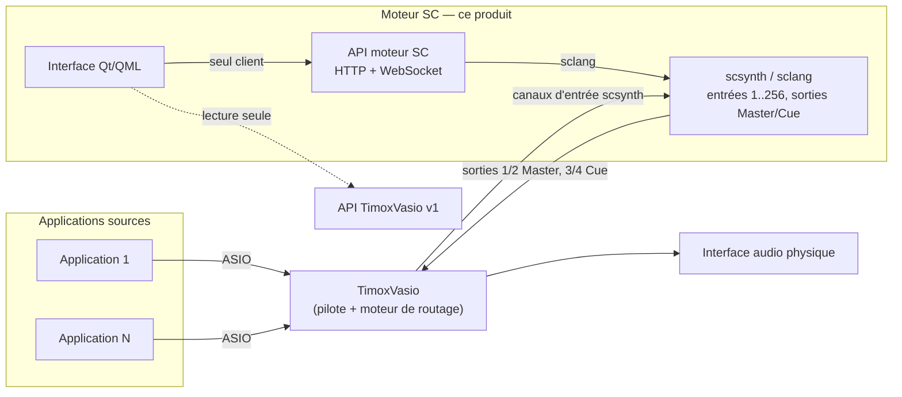

# Moteur SC générique et interface native Qt — conception

Date : 5 novembre 2026.

Statut : proposition soumise à validation de l'utilisateur.

## 1. Intention

Disposer du moteur de traitement SuperCollider de Mixette au travers d'une interface native (non web), et profiter de cette refonte pour redéfinir le périmètre du produit autour de SuperCollider seul.

Le principe est généralisé :

- un nombre indéterminé de ports d'entrée (limité à 256 canaux) reçoit des sources sonores ;
- le moteur SC applique des traitements en temps réel ;
- le son sort par les sorties Master et Cue ;
- TimoxVasio est seul responsable des liens entre les applications sources, les sorties matérielles et le moteur SC.

L'objectif fonctionnel est de reconstruire dans l'interface native tous les réglages SC disponibles aujourd'hui dans l'interface web.

## 2. Décisions de l'utilisateur

| Sujet | Décision |
|---|---|
| Framework de l'interface | Qt 6.12 (QML), déjà installé (`C:\Qt\6.12.0`) et utilisé par `qt/k3-surface` |
| Périmètre | Nouvelle API limitée au moteur SC. L'ancien contrat SC et ses vues web deviennent invalides. K3, pilotage Mixxx, horloge MIDI, workflow et catalogues d'applications sortent de ce produit |
| Unité d'entrée | Une source déclare une largeur libre de 1 à N canaux ; le total des canaux déclarés est ≤ 256 |
| Sorties | Master et Cue fixes, stéréo, avec la chaîne de traitement actuelle |
| Persistance | La session (sources et tous leurs réglages, Master, Cue) est enregistrée automatiquement par le moteur et restaurée au démarrage ; les `id` de source sont stables |
| Presets | Un preset est une session complète (définition des sources, traitements, Master, Cue). L'appliquer remplace la configuration entière |
| Pilote audio | Le moteur est verrouillé sur TimoxVasio ; seuls la fréquence d'échantillonnage et la taille de buffer sont réglables |
| Transition | Ce chantier construit uniquement le nouveau produit. Le retrait de l'ancien (`api/`, `hub/`, `ui/`, `qt/k3-surface`) est un chantier ultérieur distinct |

## 3. Objectifs, non-objectifs, anti-objectifs

**Objectifs**

- Sources génériques : création, renommage, suppression, largeur et premier canal d'entrée scsynth déclarés par l'utilisateur. Aucune identité d'application (Renoise, Mixxx, SSL, Ableton, Traktor) n'est codée dans le moteur, l'API ou l'interface.
- Parité fonctionnelle avec les réglages SC de l'interface web (inventaire en section 6).
- Interface Qt cliente exclusive de la nouvelle API (HTTP + WebSocket), pilotable entièrement à la souris.
- Vumètres par source, Master L/R et Cue L/R.

**Non-objectifs**

- Gestion des routes TimoxVasio par le moteur SC. L'API SC ne crée, ne modifie et n'applique aucune route TimoxVasio.
- Contrôleurs MIDI (K3 ou autres), horloge MIDI, mode de performance, pilotage Mixxx/Renoise, éditeur de workflow.
- Sorties supplémentaires au-delà de Master et Cue.
- Le chantier Electron du 21 octobre ne s'applique pas à ce produit ; l'installation est décrite en section 12.
- Installation de Node.js et de TimoxVasio par l'installateur : ce sont des prérequis vérifiés.
- Pilotes ASIO autres que TimoxVasio.
- DCompressor : absent de l'interface web actuelle, il n'entre pas dans la parité.
- Retrait de l'ancien produit (chantier ultérieur).

**Anti-objectifs** (échec même si cela fonctionne)

- Deux chemins de fonctionnement : l'ancien contrat SC (`/api/objects/supercollider/processing/*`, `sourceId ≤ 10`, decks 1–4) ne doit subsister ni dans l'API, ni dans les tests, ni dans une vue.
- Un état métier lu ou reconstruit côté client (fichier, cache local, table de traduction) au lieu de l'API.
- Un nombre de sources, une largeur ou un nom d'application figé dans `hub.scd`, l'API, le schéma ou l'interface.
- Un remplacement silencieux de modèle de traitement (ex. DCompressor absent remplacé par Compander).

## 4. Architecture



- **scsynth** ouvre TimoxVasio comme périphérique ASIO, avec 256 canaux d'entrée et 4 canaux de sortie (Master 1/2, Cue 3/4). Le nom du pilote n'est pas modifiable par l'API.
- **API moteur SC** : service Node.js local. Elle reprend la gestion du cycle de vie sclang/scsynth, la file de commandes et le relais OSC des vumètres existants (`hub/moteur.js`, `hub/sc-command-dispatch.js`, `hub/services/AudioMeterBridge.js`), réduits au périmètre SC. Choix de l'intégrateur : réutiliser Node plutôt que réécrire le service en C++, car le cycle de vie SC et la file de commandes sont déjà éprouvés.
- **Interface Qt** : application QML/C++ autonome, cliente HTTP/WebSocket (`QNetworkAccessManager`, `QWebSocket`). Elle ne lit aucun fichier de configuration du moteur.
- **TimoxVasio** : l'interface Qt affiche, en lecture seule, quelle extrémité TimoxVasio alimente chaque canal d'entrée scsynth et vers quelle sortie physique vont Master et Cue, en lisant `GET /api/v1/state` de l'API TimoxVasio. Pour retrouver les extrémités de scsynth (`virtual:TimoxVasio:<pid>:...`) sans table locale, l'API SC publie le PID de scsynth dans `/api/engine` (choix de l'intégrateur). La modification des routes reste dans l'interface TimoxVasio.

### 4.1 Démarrage et cycle de vie

Choix de l'intégrateur :

- Un lanceur `engine/engine.cmd` démarre le service Node et l'enregistre (PID, commande) dans un registre runtime propre au produit. L'interface Qt ne lance pas le service. En son absence, elle affiche « API indisponible » et réessaie la connexion.
- Le service ne démarre pas scsynth automatiquement. scsynth démarre sur `POST /api/engine/start`, puis la session persistée est restaurée avant l'activation des contrôles. Pendant la restauration, les mutations sont refusées explicitement.
- Le service refuse de démarrer si son port ou le client scsynth TimoxVasio est occupé par un processus qu'il n'a pas lancé. Il ne s'y connecte pas. L'ancien produit et le nouveau ne fonctionnent donc jamais en même temps.

## 5. Modèle des sources et des sorties

### 5.1 Source

```text
Source {
  id: string            // identifiant stable attribué par l'API
  name: string          // libellé libre, 1..60 caractères
  firstChannel: int     // premier canal d'entrée scsynth, à partir de 1
  width: int            // 1..N canaux
  processing: SourceProcessing
}
```

- Règles de validation : `firstChannel + width - 1 ≤ 256`. Deux sources ne peuvent pas partager un canal ; un chevauchement est refusé avec une erreur documentée.
- Création, modification de largeur ou de canal et suppression d'une source : sans redémarrage de scsynth. Le moteur crée ou libère les groupes et synthés de la source ; le reste du graphe continue de sonner.
- Mise en stéréo vers Master/Cue :
  - largeur 1 : panoramique mono (`Pan2`) ;
  - largeur 2 : balance stéréo (comportement actuel de `pan`) ;
  - largeur > 2 : répartition sur le champ stéréo (`Splay`), puis balance.

  Choix de l'intégrateur.
- Les traitements opèrent sur la largeur native de la source jusqu'à la mise en stéréo. Les SynthDefs sont générées par largeur à la demande ; une largeur déjà compilée n'est pas recompilée.
- Sur une source à plusieurs canaux, le compresseur d'entrée et chaque bande du compresseur multibande détectent en mode lié : le niveau le plus fort parmi les canaux pilote une réduction de gain commune. Cela préserve l'image stéréo. Choix de l'intégrateur.
- `id` : chaîne attribuée à la création, stable entre redémarrages grâce à la persistance. Il n'est jamais réutilisé après suppression.

### 5.2 Chaîne de traitement par source

Ordre fixe, repris de l'existant : entrée (gain + compresseur) → EQ 3 bandes → HP → LP → pitch → compresseur multibande → mix (volume, mute, balance, envoi Cue) → Master et Cue.

### 5.3 Sorties Master et Cue

Stéréo, fixes. Chaîne : HPF infra → HPF latéral (M/S) → EQ → volume → clipper → limiteur → compresseur. Master sur sorties scsynth 1/2, Cue sur 3/4.

## 6. Réglages à reconstruire (parité)

Paramètres, plages et valeurs par défaut identiques à l'existant sauf mention contraire.

### 6.1 Par source

| Réglage | Plage / défaut |
|---|---|
| Volume | 0–1, défaut 1 |
| Envoi Cue | 0–1, défaut 0 |
| Mute | booléen. Une nouvelle source est créée non muette (choix de l'intégrateur ; la règle actuelle « source 5 muette » disparaît) |
| Balance | 0–1, 0,5 = centre. Disponible pour toutes les sources (remplace `decks/{n}/crossfader`) |
| Gain d'entrée | 0–1, défaut 1 |
| Compresseur d'entrée | seuil −80..0 dB (−20), ratio 1..16 (4), attaque 1..100 ms (10), relâchement 10..1000 ms (100), makeup ±24 dB (0), bypass (vrai) |
| EQ 3 bandes | 0–1 par bande, 0,5 = neutre, ±12 dB ; 80 Hz / 1 kHz / 8 kHz ; trajet direct quand neutre |
| Filtre HP | modèle BHiPass / RHPF / BHiPass4 ; fréquence 20 Hz–20 kHz log ; Q 0,5–10 ; mul 0–2 ; add −1..1 ; activation ; réinitialisation |
| Filtre LP | modèle BLowPass / RLPF / BLowPass4 / MoogFF ; MoogFF utilise `gain` 0–4 et `reset` ; mêmes autres paramètres |
| Pitch | −12..+12 demi-tons, pas de 1 |
| Compresseur multibande | 3 bandes, 5 paramètres + bypass chacune, croisements LR4 250 Hz / 4 kHz |

### 6.2 Master et Cue

| Réglage | Plage / défaut |
|---|---|
| Volume | 0–1, défaut 1 |
| EQ | ±12 dB ; 200 Hz / 1 kHz / 8 kHz |
| HPF infra | activation (faux), 20–200 Hz (25) |
| HPF latéral M/S | activation (faux), 20–1000 Hz (100) |
| Clipper | activation (faux), plafond −24..0 dBFS (0) |
| Limiteur | activation (faux), plafond −24..0 dBFS (−1), anticipation 10 ms |
| Compresseur | modèle Compander / CompanderD / FaustRMS ; seuil, slopeBelow, slopeAbove, attaque, relâchement, mul, add, bypass ; changement de modèle en fondu. L'API publie pour chaque modèle sa disponibilité réelle (ex. plugin `MixetteFaustRMS.scx` absent). La sélection d'un modèle indisponible est refusée par une erreur documentée, et l'état reste inchangé (choix de l'intégrateur) |
| Copier Master → Cue | action |
| Graphe de traitement | lecture seule |

### 6.3 Global et moteur

| Fonction | Contenu |
|---|---|
| Profil audio | fréquence d'échantillonnage et taille de buffer (pilote fixé à TimoxVasio). Une modification exige un redémarrage de scsynth, annoncé par l'API ; la session persistée est restaurée ensuite |
| Persistance | enregistrement automatique de la session à chaque mutation confirmée. Le fichier est stocké dans le répertoire de données du moteur et n'est lu que par l'API. Au premier lancement, la session est vide (aucune source) |
| Cycle de vie | démarrer, arrêter, redémarrer ; état publié par événement ; PID scsynth publié |
| Runtime | CPU, nombre de synthés/UGens/groupes, fréquence demandée/effective, taille de bloc, buffer matériel, latence, dernier `/fail` ; arbre des nœuds |
| Presets | lister, enregistrer, appliquer, supprimer. Un preset est un instantané complet de la session : sources (id, nom, canal, largeur), tous leurs réglages, Master et Cue. L'application remplace la session entière. Elle crée, modifie et supprime les sources nécessaires, sans redémarrer scsynth, et la nouvelle session est persistée. Un preset invalide (chevauchement, dépassement de 256 canaux, modèle indisponible) est refusé en bloc, et la session reste inchangée |
| Banc compresseur | exécution 3 s sur signal interne |
| Banc EQ | bruit rose à la place de Master, méthodes `legacyStack` / `threeBand` |
| Vumètres | crête + RMS en dBFS, 10 Hz : un par source (maximum des canaux, choix de l'intégrateur), Master L/R, Cue L/R |

Le format de preset change avec les sources génériques. Les presets existants (6, 7 ou 11 sources fixes) ne sont pas importés.

## 7. Contrat d'API

Un nouveau fichier `openapi.yaml` décrit uniquement le moteur SC. Ressources principales :

| Ressource | Opérations |
|---|---|
| `/api/state` | état complet : moteur, profil audio, sources, Master, Cue |
| `/api/engine` | état (dont PID scsynth), `start`, `stop`, `restart`, runtime, arbre des nœuds |
| `/api/engine/audio-profile` | lecture, écriture (fréquence, buffer) |
| `/api/sources` | liste, création |
| `/api/sources/{id}` | lecture, modification (nom, canal, largeur), suppression |
| `/api/sources/{id}/processing/...` | une route par traitement de la section 6.1 |
| `/api/outputs/{master\|cue}/...` | une route par traitement de la section 6.2 |
| `/api/presets` | liste, création, application, suppression |
| `/api/benches/...` | bancs compresseur et EQ |
| WebSocket `/api/ws` | événements `stateChanged`, `engineStateChanged`, `engineRuntimeChanged`, `sourceMeter`, `outputMeter` |

- Toute mutation renvoie l'état confirmé après acquittement sclang. L'interface met à jour sa vue depuis cette réponse et les événements, sans état optimiste.
- Une valeur hors plage ou un champ inconnu est refusé (corps strict).
- Le lissage de contrôle de 50 ms s'applique à toutes les mutations venant de l'API.

## 8. Interface Qt

- Fenêtres ou onglets : **Sources** (une tranche par source, ajout/suppression), **Sorties** (Master, Cue), **Presets**, **Moteur** (profil audio, cycle de vie, runtime, arbre des nœuds, bancs), **Routage** (vue TimoxVasio en lecture seule).
- Contrôles : potentiomètres, faders et vumètres QML dédiés ; courbe de réponse des filtres HP/LP et courbe statique du compresseur, calculées depuis les paramètres publiés par l'API et la fréquence d'échantillonnage effective publiée par `/api/engine`.
- Le nombre de tranches s'adapte au nombre de sources (défilement horizontal).
- Une perte de connexion à l'API est affichée et les contrôles sont désactivés jusqu'à la reconnexion.
- La disposition visuelle détaillée est laissée au constructeur, dans le ton des consignes `docs/CONSIGNES_DESIGNER.md`.

## 9. Transition

- Le nouveau produit est construit dans `mixette-SCEngine` : `engine/` (API, scripts SC, contrat `engine/openapi.yaml`, tests) et `desktop/` (Qt). Choix de l'intégrateur.
- Le code repris de `hub/` (cycle de vie SC, file de commandes, relais des vumètres, SynthDefs) est copié et réduit dans `engine/`. `engine/` n'importe rien de `api/`, `hub/` ni `ui/`.
- Ce chantier ne retire pas l'ancien produit. Son retrait (`api/`, `hub/`, `ui/`, `qt/k3-surface`, ancien `openapi.yaml`, tests de l'ancien contrat, identités figées `sc-audio-map.js`, `source-topology.js`, `timoxvasio-routing.js`) fait l'objet d'un chantier ultérieur distinct.
- Les tests du nouveau contrat refusent l'ancien : routes `/api/objects/supercollider/*`, `decks/*`, `sourceId` numérique borné à 10, champ de choix du pilote audio.
- Dans le nouveau produit, sclang n'ouvre aucun contrôleur MIDI. Les gestes K3 ne pilotent pas le nouveau moteur.

## 10. Preuves attendues

- Tests de contrat de l'API : corps complets, refus de l'ancien contrat, création/suppression de sources de largeurs 1, 2 et > 2, limite 256 et chevauchement.
- Persistance : la session est identique (sources, id, réglages) après le redémarrage de l'API et de scsynth, et après un changement de profil audio.
- Presets : l'application d'un preset dont les sources diffèrent de la session courante donne exactement l'instantané enregistré ; un preset invalide laisse la session inchangée.
- Concordance état API ↔ contrôles scsynth (`/g_queryTree`) après chaque mutation.
- Création et suppression de source pendant que Master sonne, sans coupure audible de Master.
- Vérification visuelle de l'interface Qt sur chaque onglet.
- L'écoute réelle à travers TimoxVasio et la sortie analogique reste une preuve distincte, consignée séparément.

## 11. Laissé au constructeur

- Disposition visuelle et style QML.
- Découpage interne du service Node et des scripts sclang.
- Mécanisme de génération des SynthDefs par largeur.
- Format et emplacement exacts du fichier de session et des presets (JSON versionné, dans le répertoire de données du moteur).
- Port d'écoute de l'API (loopback uniquement), sous réserve qu'il soit publié et non réutilisé s'il est occupé par un processus inconnu.

## 12. Installateur Windows

Ajout demandé par l'utilisateur le 5 novembre 2026.

| Sujet | Décision |
|---|---|
| Outil | Qt Installer Framework |
| Contenu | Application Qt (`desktop/`), service moteur (`engine/`, avec ses dépendances `node_modules` de production), SuperCollider 3.14.1 embarqué |
| SuperCollider | Embarqué dans un sous-dossier dédié de l'installation (`supercollider\`) : version figée, sans interférence avec une autre installation de SC |
| Prérequis vérifiés, non installés | Node.js (même version majeure que celle utilisée en développement) et le pilote TimoxVasio. Leur absence arrête l'installation avec un message explicite |

- SuperCollider est placé dans son propre sous-dossier, car sa distribution contient ses propres DLL Qt 6. Elles ne doivent pas se trouver dans le dossier de l'application Qt. Choix de l'intégrateur.
- Le service moteur utilise le sclang, le scsynth et les plugins du sous-dossier embarqué. Le chemin est résolu par rapport au dossier d'installation ; l'interface ne le connaît pas.
- Les données utilisateur (`session.json`, presets, registre runtime) restent dans `%LOCALAPPDATA%\Mixette\sc-engine\`. La désinstallation ne les supprime pas.
- Le fichier `COPYING` de SuperCollider est installé avec le sous-dossier embarqué.
- L'installateur crée un raccourci qui lance le service moteur puis l'application Qt, par un lanceur unique. Ce lanceur applique les règles de PID d'AGENTS.md.
