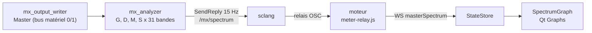

# Analyseur de spectre de la sortie Master — conception

## Intention

Voir en direct le contenu fréquentiel de la sortie Master, en particulier vérifier qu'il ne reste pas de grave
dans le signal latéral (S) après le passe-haut latéral. Aujourd'hui, SCMixer n'a que des vumètres crête/RMS par
canal et des courbes théoriques de réglage ; la vérification passe par un enregistrement analysé hors de SCMixer.

## Décisions de l'utilisateur

- Signaux analysés : centre (M), côtés (S), gauche (G) et droite (D).
- Sortie analysée : Master uniquement.
- Activation : à la demande uniquement ; l'analyse est arrêtée par défaut et à chaque démarrage du moteur.
- Affichage : courbes.

## Non-objectifs

- Pas d'analyse de la sortie Cue ni des sources.
- Pas de spectrogramme défilant, pas de FFT fine.
- Pas de mesure de corrélation ou de goniomètre.

## Mesures de l'essai préalable (2026-11-06, scsynth de test MME)

- 31 bandes en tiers d'octave sur M et S (deux BPF en cascade, RQ 0,2316, RMS lissé) : CPU moyen de 0,35 % à 5,4 %
  (crête 6,1 %). Séparation M/S mesurée : 60 Hz en M seul donne M = −18 dB, S = −96,5 dB ; 1 kHz en S seul donne
  S = −23 dB, M = −91 dB.
- Qt Graphs 6.12 : `GraphsView` + `LogValueAxis` + deux `LineSeries` mises à jour par `replace(points)` à 20 Hz ;
  rendu correct dans l'application ; dans QuickTest hors écran, `grabImage` rend une image blanche, `grabToImage`
  rend les courbes ; `windeployqt` embarque Qt Graphs (environ +11 Mo, dont Qt Quick 3D).

## Fonctionnement

### Moteur SuperCollider

- SynthDef `\mx_analyzer` : lit le bus matériel de la sortie Master (2 canaux, après tous les traitements, comme
  l'enregistrement), calcule G, D, M = (G+D)/2, S = (G−D)/2.
- 31 bandes ISO en tiers d'octave, centres 1000 · 2^((i−17)/3) Hz pour i = 0..30 (20 Hz à 20 kHz).
- Chaque bande : deux `BPF` en cascade (RQ 0,2316), puis RMS par carré, `LPF` à 8 Hz et racine.
- `SendReply.kr(Impulse.kr(15), '/mx/spectrum', …)` : 124 valeurs linéaires, dans l'ordre G, D, M, S.
- Le synthé est placé dans un groupe après le groupe des sorties ; il est créé au démarrage de l'analyse et libéré
  à l'arrêt. Aucune écriture sur un bus.
- Coût attendu : environ le double de l'essai (quatre signaux au lieu de deux), soit de l'ordre de 10 % d'un cœur DSP,
  uniquement quand l'analyse est active.

### API

- `GET /api/analyzer` → `Analyzer` : `{ state: "stopped" | "running", bandsHz: number[31], rateHz: 15 }`.
- `POST /api/analyzer/start` et `POST /api/analyzer/stop` : corps vide ; réponse `Analyzer`.
  - Moteur arrêté : `start` refusé en 409 `ENGINE_NOT_RUNNING`.
  - `start` déjà démarré ou `stop` déjà arrêté : 409 `ANALYZER_STATE`.
- `GET /api/state` porte `analyzer`.
- Événements WebSocket :
  - `analyzerChanged` : `Analyzer`, à chaque changement d'état ;
  - `masterSpectrum` : `{ left, right, mid, side }`, quatre tableaux de 31 valeurs en dBFS, plancher −120 dB
    (même conversion que les vumètres).
- Arrêt ou échec du moteur : l'analyseur passe à `stopped` et publie `analyzerChanged`.

### Interface

- Nouveau composant `SpectrumGraph.qml` (Qt Graphs) : axe X logarithmique 20 Hz – 20 kHz, axe Y −96 à 0 dBFS.
- Deux courbes à la fois, avec un sélecteur « M/S » ou « G/D ». En vue M/S, un repère vertical marque la
  fréquence du passe-haut latéral de la sortie Master quand il est actif.
- Bouton « Spectre » pour démarrer et arrêter l'analyse ; désactivé quand le moteur est arrêté.
- Les tests QML capturent l'image avec `grabToImage`.

## Choix laissés à l'implémentation, faits par Claude

- Emplacement de l'interface : un panneau repliable sous la barre d'enregistrement, visible sur tous les onglets ;
  replier le panneau arrête l'analyse.
- Lissage : seulement le `LPF` à 8 Hz côté SuperCollider ; pas de maintien des crêtes.
- Cadence de 15 Hz.
