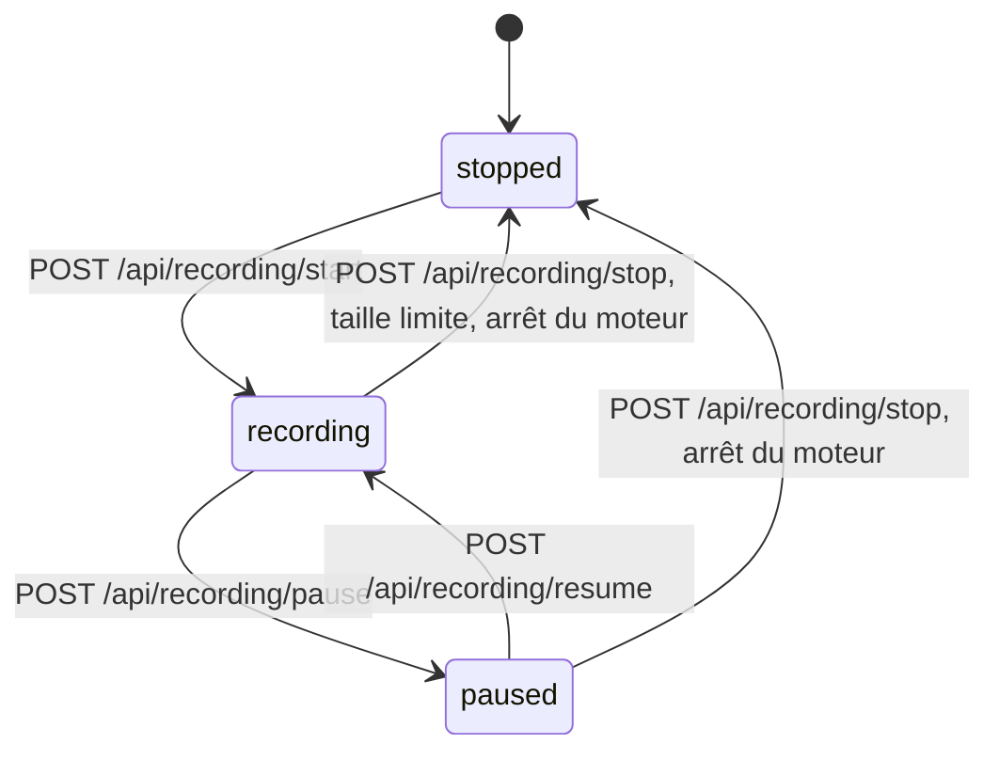

# Enregistrement WAV de la sortie Master

Date : 2026-11-06. Statut : à valider.

## Intention

Garder une trace fidèle de ce qui sort de SCMixer après traitements, pour l'archive, la réécoute, la comparaison de versions et, le cas échéant, la diffusion. Le fichier doit contenir exactement le signal envoyé à la carte sur la sortie Master, sans retraitement à l'enregistrement.

## Objectifs

- Enregistrer la sortie Master (stéréo) dans un fichier WAV non compressé.
- Commandes : démarrer, mettre en pause, reprendre, arrêter.
  - Pause puis reprise : le même fichier continue, sans le temps de pause.
  - Arrêt : le fichier est fermé et complet.
  - Chaque démarrage crée un nouveau fichier.
- Caractéristiques choisies au démarrage : précision 16 bits entiers, 24 bits entiers (défaut) ou 32 bits flottants.
- Fichiers dans `Documents\SCMixer\Enregistrements`, nommés par date et heure de démarrage.
- Commandes et état disponibles depuis tous les onglets de l'interface.

## Hors périmètre

- Enregistrement de la sortie Cue, des sources ou de plusieurs sorties à la fois.
- Formats compressés (MP3, FLAC…), rééchantillonnage, normalisation, fondu.
- Choix du dossier par l'utilisateur, lecture ou gestion des fichiers dans l'interface.

## À éviter absolument

- Un fichier qui ne correspond pas à ce qui est entendu sur Master, par exemple capté avant le compresseur, le limiteur ou l'écrivain de sortie.
- Un fichier corrompu ou sans en-tête valide après un arrêt normal, un arrêt du moteur ou l'atteinte de la taille limite.
- Un enregistrement qui continue silencieusement, ou qui s'arrête sans que l'interface l'affiche.
- Toute perturbation du son en sortie : pas de rupture audio au démarrage, à la pause, à la reprise ou à l'arrêt.

## Caractéristiques du fichier

| Caractéristique | Valeur |
|---|---|
| Conteneur | WAV (RIFF), PCM non compressé |
| Canaux | 2 (Master gauche, droite) |
| Fréquence d'échantillonnage | celle du serveur audio, aujourd'hui 48 000 Hz ; aucun rééchantillonnage |
| Précision | `int16`, `int24` (défaut) ou `float` (32 bits flottants) |
| Taille maximale | 4 Go (limite du WAV) : l'enregistrement s'arrête proprement juste avant, avec un motif d'arrêt visible |

Ordres de grandeur en stéréo à 48 kHz : 16 bits ≈ 0,69 Go/h, 24 bits ≈ 1,04 Go/h, 32 bits ≈ 1,38 Go/h. La limite de 4 Go correspond donc à environ 5 h 50 en 16 bits, 3 h 50 en 24 bits et 2 h 50 en 32 bits.

Nom de fichier : `AAAA-MM-JJ_HH-MM-SS_master.wav` (heure locale du démarrage). Si le nom existe déjà, le moteur refuse le démarrage plutôt que d'écraser un fichier.

## Fonctionnement

Le point de captation est le bus matériel 0/1 du serveur, en fin de chaîne : après l'écrivain de sortie Master, et après le moniteur du banc EQ s'il est actif. Ce qui est enregistré est donc exactement ce qui part vers la carte sur Master. Le synthé d'enregistrement est placé dans un groupe qui s'exécute après `~mxOutputGroup`.

Côté SuperCollider : un tampon disque est ouvert en écriture (`Buffer.alloc` puis `write` avec `leaveOpen: true`, format `wav` et la précision choisie), puis un synthé `DiskOut` lit `In.ar(0, 2)`. La pause arrête l'exécution du synthé (`run(false)`) : rien n'est écrit pendant la pause. La reprise la relance. L'arrêt libère le synthé, puis ferme et libère le tampon : la fermeture écrit l'en-tête définitif.

## API

L'API reste le seul passage, comme le reste du moteur. Les commandes passent par la file de mutations existante.

- `GET /api/recording` : état courant.
- `POST /api/recording/start`, corps `{ "sampleFormat": "int16" | "int24" | "float" }` : refusé si un enregistrement est en cours ou en pause, si le moteur n'est pas en marche, ou si le fichier existe déjà.
- `POST /api/recording/pause` : refusé hors de l'état `recording`.
- `POST /api/recording/resume` : refusé hors de l'état `paused`.
- `POST /api/recording/stop` : refusé à l'état `stopped`.
- Événement WebSocket `recordingChanged` à chaque changement d'état, avec le même objet que `GET`.
- L'état d'enregistrement fait aussi partie de l'état complet envoyé à la connexion, comme les autres données du moteur.

Objet d'état :

| Champ | Contenu |
|---|---|
| `state` | `stopped`, `recording`, `paused` |
| `file` | chemin complet du fichier en cours, ou du dernier fichier fermé ; `null` si aucun |
| `sampleFormat` | précision du fichier en cours ou du dernier fichier |
| `sampleRate`, `channels` | caractéristiques du fichier |
| `recordedSeconds` | durée enregistrée hors pauses |
| `bytes` | taille estimée des données audio |
| `stopReason` | `null` en cours ; sinon `user`, `sizeLimit`, `engineStopped` ou `error` |
| `error` | message si `stopReason` vaut `error`, sinon `null` |

Pendant l'enregistrement, `recordingChanged` est aussi émis une fois par seconde pour faire avancer la durée et la taille.

Le contrat est décrit dans `engine/openapi.yaml`, avec ses tests de contrat, avant l'implémentation.

## Interface

Dans la barre moteur, visible sur tous les onglets :

- un choix de précision (16 bits, 24 bits, 32 bits flottants), modifiable seulement à l'arrêt ;
- des boutons Enregistrer, Pause / Reprendre et Arrêter, chacun actif seulement quand l'API l'accepte ;
- un voyant d'état, la durée enregistrée, la taille et le nom du fichier en cours ou du dernier fichier ;
- le motif d'arrêt s'il n'est pas `user` (taille limite, moteur arrêté, erreur).

L'interface n'affiche que ce que l'API publie : elle ne calcule ni durée, ni taille, ni chemin.

## Cas limites

- **Arrêt ou redémarrage du moteur pendant l'enregistrement** : le fichier est fermé proprement avant l'arrêt de scsynth, avec le motif `engineStopped`.
- **Plantage de scsynth** : le fichier peut garder un en-tête incomplet. La plupart des lecteurs le lisent quand même. C'est une limite connue, non corrigée ici.
- **Banc EQ actif** : ce qui est entendu sur Master, le bruit du banc, est enregistré. C'est cohérent avec la règle « ce qui sort sur Master ».
- **Dossier absent** : il est créé au démarrage de l'enregistrement.
- **Disque plein ou erreur d'écriture** : arrêt avec le motif `error`, et le message visible dans l'interface et le journal.

## Choix laissés au constructeur

- La détection du dossier Documents de Windows, y compris quand il est redirigé (OneDrive, déplacement par l'utilisateur), par le dossier connu de Windows plutôt qu'un chemin construit à la main.
- La taille du tampon disque.
- La marge exacte avant 4 Go.
- La façon de mesurer la durée et la taille : nombre d'images écrites, ou horloge du moteur hors pauses.
- La disposition exacte des contrôles dans la barre moteur.
