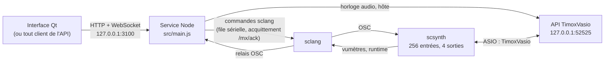
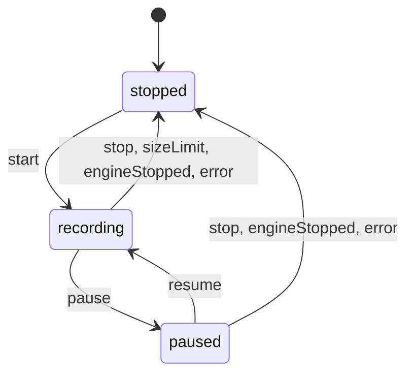

# Moteur de SCMixer

Service local qui pilote un moteur SuperCollider à sources génériques : de 1 à 256 canaux d'entrée répartis entre des sources de largeur libre, une chaîne de traitement par source, et deux sorties stéréo fixes, Master (sorties 1/2) et Cue (sorties 3/4). Le service est le seul point d'accès au moteur : HTTP et WebSocket sur `127.0.0.1`, contrat décrit dans `openapi.yaml`.

## Architecture



- Les mutations sont validées (corps stricts), sérialisées, exécutées dans sclang, puis la session confirmée est enregistrée et diffusée (`stateChanged`).
- Au démarrage du moteur, la fréquence d'échantillonnage et la taille de bloc sont lues sur l'API TimoxVasio. Si l'hôte TimoxVasio est absent, le moteur le lance et l'inscrit au registre ; il ne crée aucune route TimoxVasio.
- scsynth est dimensionné au démarrage à partir des besoins calculés (`src/runtime/server-options.js`).

## Prérequis

- Node.js (le service est un module ESM ; dépendances : `npm ci` dans ce dossier).
- SuperCollider 3.14.1, par défaut dans `C:\Program Files\SuperCollider-3.14.1` (option `--sc-dir` pour un autre dossier).
- Le pilote et l'hôte TimoxVasio. L'hôte doit avoir un pilote physique configuré ; sinon le démarrage du moteur est refusé (409 `TIMOXVASIO_NOT_READY`, avec la cause).

## Démarrage et arrêt

```
engine.cmd start [--sc-dir <dossier>]
engine.cmd status
engine.cmd stop
```

- `start` lance `node src/main.js` en arrière-plan, inscrit son PID et sa ligne de commande dans le registre (`runtime-processes.json`, rôle `service`), puis attend que `GET /api/engine` réponde. S'il est déjà démarré, il ne fait rien.
- Le service ne démarre pas SuperCollider : `POST /api/engine/start` le fait, puis la session enregistrée est restaurée.
- `stop` demande l'arrêt du moteur (`POST /api/engine/stop`) puis arrête le service, uniquement si le PID et la ligne de commande correspondent à l'entrée du registre. Un PID réattribué à un autre programme n'est jamais arrêté : l'entrée est retirée et signalée.
- Le service refuse de démarrer si son port est déjà occupé ; il ne réutilise jamais un service existant.

## Variables d'environnement

| Variable | Rôle | Défaut |
|---|---|---|
| `SCMIXER_ENGINE_PORT` | Port d'écoute de l'API (loopback) | `3100` |
| `SCMIXER_ENGINE_DATA_DIR` | Dossier de données | `%LOCALAPPDATA%\SCMixer` |
| `SCMIXER_TIMOXVASIO_URL` | API TimoxVasio | `http://127.0.0.1:52525` |
| `SCMIXER_TIMOXVASIO_ENGINE_EXE` | Hôte TimoxVasio lancé s'il est absent | `C:\Program Files\TimoxVSSC\resources\backend\TimoxVirtualAsioEngine.exe` |
| `SCLANG_PATH` | sclang à utiliser à la place de celui de `--sc-dir` | — |
| `SCMIXER_RECORDINGS_DIR` | Dossier des enregistrements WAV | `Documents\SCMixer\Enregistrements` (dossier Documents connu de Windows) |

## Données

Dans le dossier de données :

| Fichier | Contenu |
|---|---|
| `session.json` | Session courante (sources, réglages, Master, Cue), enregistrée après chaque mutation confirmée et restaurée au démarrage du moteur |
| `presets\preset-<n>.json`, `presets\sequence.json` | Presets (instantanés complets de la session) et compteur d'identifiants |
| `runtime-processes.json` | Registre des processus lancés : service, sclang, lanceur de scsynth, scsynth, hôte TimoxVasio s'il a été lancé par le moteur |
| `service.log` | Sortie du service lancé par `engine.cmd` |
| `logs\sclang.log` | Sortie de sclang, un bloc horodaté par démarrage |

Ces fichiers ne sont lus que par le service. Aucun client ne doit les lire.

## Enregistrement

`POST /api/recording/start` (corps `{ "sampleFormat": "int16" | "int24" | "float" }`), puis `pause`, `resume` et `stop`, enregistrent la sortie Master dans un fichier WAV stéréo à la fréquence du serveur audio. L'état est publié par `GET /api/recording` et l'événement `recordingChanged`.

- **Point de captation** : le bus matériel 0/1, en fin de chaîne. C'est exactement ce qui part vers la carte sur Master, y compris le banc EQ s'il est actif.
- **Fichiers** : `AAAA-MM-JJ_HH-MM-SS_master.wav` dans le dossier des enregistrements. Un fichier existant n'est jamais écrasé.
- **Arrêt automatique** :
  - juste avant 4 Go de données (`sizeLimit`) ;
  - quand l'espace libre passe sous 64 Mio (`error`) ;
  - avant l'arrêt du moteur (`engineStopped`, fichier fermé avant celui de scsynth) ;
  - au plantage de scsynth (`error`). Dans ce cas, l'en-tête du fichier peut rester incomplet.



## Contrat

`openapi.yaml` décrit toutes les routes et les événements WebSocket (`/api/ws`). Points d'entrée principaux :

- `GET /api/state` : état complet ; `GET /api/parameters` : catalogue des paramètres (plages, défauts, unités, conditions d'usage) ;
- `/api/engine` : cycle de vie, runtime, arbre des nœuds ;
- `/api/sources` et `/api/sources/{id}/processing/...` ; `/api/outputs/{master|cue}/...` ;
- `/api/presets` ; `/api/benches/...`.

## Niveaux de preuve

1. Acquittement sclang : chaque mutation n'est confirmée qu'après `/mx/ack` de la commande correspondante.
2. Arbre scsynth : `GET /api/engine/node-tree` relit `/g_queryTree` sur le serveur.
3. Écoute réelle à travers TimoxVasio et la sortie analogique : faite par l'utilisateur, consignée séparément.

## Tests

```
npm test
```

Les tests de l'API utilisent un faux sclang. `tests/sc-integration.test.js` démarre de vrais sclang et scsynth sur des serveurs de test (sortie MME, ports dédiés), jamais sur TimoxVasio.

## Vérification réelle

Le 6 novembre 2026, sur le poste de développement, avec un dossier de données dédié (`SCMIXER_ENGINE_DATA_DIR=%LOCALAPPDATA%\SCMixer-verify`) :

```
engine.cmd start
node tools/verify-runtime.mjs
engine.cmd stop
```

- Inventaire préalable : aucun processus de l'ancien produit, aucun sclang ni scsynth ; hôte TimoxVasio lancé par son interface (non lancé par le moteur), transport démarré, 48 000 Hz, 512 trames.
- Résultat : `VERIFY OK`. Service PID 11304 ; scsynth PID 22700 puis 7096 après le redémarrage du moteur. Sources de largeurs 1, 2 et 5 ; 38 contrôles retrouvés sur scsynth (`node-tree?controls=true`) ; session et contrôles identiques après redémarrage ; preset appliqué égal à l'instantané. Après `engine.cmd stop`, aucun processus inscrit ne restait actif.
- Défauts trouvés par les deux premiers essais et corrigés : une commande sclang de plus de 8 Ko était tronquée (restauration de trois sources), puis la valeur renvoyée par le chargement du fichier faisait échouer supercolliderjs et arrêtait le service (`src/runtime/command-queue.js`).
- Non couvert : l'écoute réelle à travers TimoxVasio et la sortie analogique.
