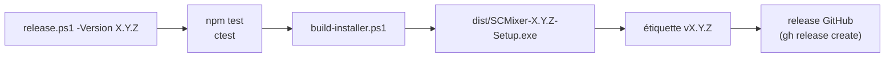

# Installateur et releases

Installateur Windows construit avec Qt Installer Framework : interface Qt, service moteur et SuperCollider 3.14.1 embarqué.



## Paquets

| Paquet | Dossier installé | Contenu |
|---|---|---|
| `fr.mixette.desktop` | `desktop\`, `Mixette.cmd` | `mixette-desktop.exe` et ses bibliothèques Qt (windeployqt), lanceur, raccourcis « Mixette SC » (menu Démarrer et bureau) |
| `fr.mixette.engine` | `engine\` | service Node.js (`src`, `sc`, `tools`, `engine.cmd`, `openapi.yaml`) et dépendances de production |
| `fr.mixette.supercollider` | `supercollider\` | `sclang.exe`, `scsynth.exe`, DLL, plug-ins Qt chargés par sclang, `SCClassLibrary`, `plugins`, `COPYING` |

Prérequis vérifiés au lancement de l'installateur (`config/controlscript.qs`) : `node --version` et la clé `HKLM\SOFTWARE\ASIO\TimoxVasio`. Un prérequis absent arrête l'installation avec un message.

`Mixette.cmd` démarre le service avec `engine.cmd start --sc-dir "<installation>\supercollider"` (PID inscrit dans le registre des processus du moteur ; un service déjà démarré est gardé), puis l'interface. La désinstallation arrête d'abord ce service (`engine.cmd stop`). Les données de `%LOCALAPPDATA%\Mixette\sc-engine` sont conservées.

## Construire

Prérequis : Qt 6.12.0 MinGW 64 et Qt Installer Framework (`C:\Qt\MaintenanceTool.exe`), Node.js, SuperCollider 3.14.1 dans `C:\Program Files\SuperCollider-3.14.1`.

```
powershell -ExecutionPolicy Bypass -File installer\build-installer.ps1 -Version 0.1.0
```

Résultat : `installer\dist\SCMixer-0.1.0-Setup.exe`. Les fichiers préparés sont dans `installer\build` (non suivis).

## Publier une release

```
powershell -ExecutionPolicy Bypass -File installer\release.ps1 -Version 0.1.0
```

Le script refuse de publier hors de `main`, avec des modifications non commitées, un `main` différent de `origin/main` ou une étiquette existante. Il exécute les tests, construit l'installateur, crée et pousse l'étiquette `v0.1.0`, puis crée la release GitHub avec l'installateur en pièce jointe (`gh`, compte authentifié).
